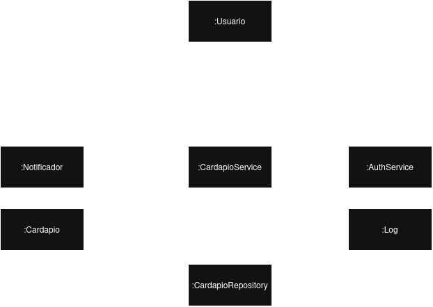
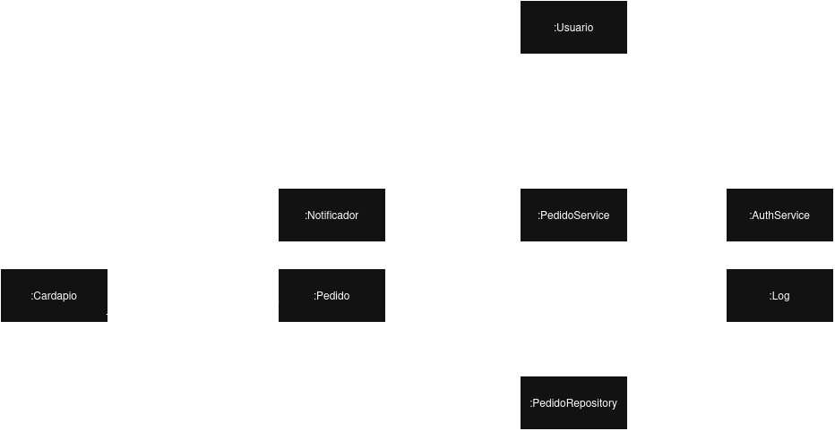
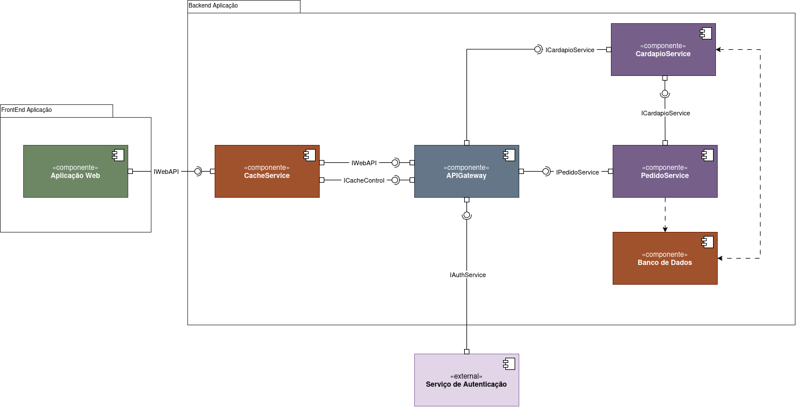

# Diagramas de Arquitetura

## Diagrama de Classes
As classes construtoras que utilizam as interfaces de `CardapioRepository`, `PedidoRepository`, `LogRepository` e `RULogin` não foram consideradas no diagrama para facilitar a visualização. No sistema atual, foi proposta apenas uma implementação concreta para cada classe.

## Diagramas de Sequência
Nos diagramas de sequência, a classe `Controller` ficou de fora pois só é responsável pelo roteamento entre os serviços, sem implementar regras de negócio complexas.

### Caso de Uso 1: Alterar Cardápio

### Caso de Uso 2: Fazer Pedido

### Caso de Uso 3: Fazer Login

## Diagramas de Comunicação
Os componentes `Tela da Aplicação`e `Controller` foram dispensados dos diagramas de comunicação para facilitar a visualização do fluxo da requisição do usuário ao sistema. O `Controller` apenas recebe a requisição e a interpreta para o serviço correspondente, sem implementar regras de negócio complexas.

---
### Caso de Uso 1: Alterar Cardápio

---
### Caso de Uso 2: Fazer Pedido

---

## Diagrama de Componentes
