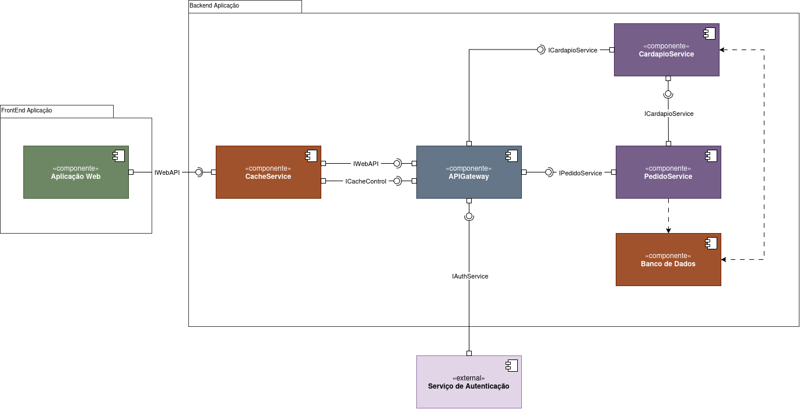
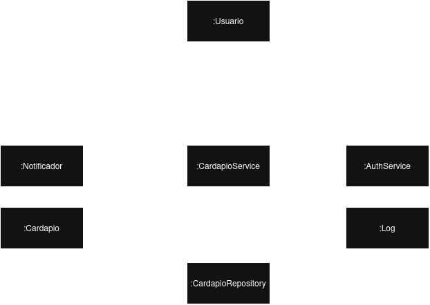
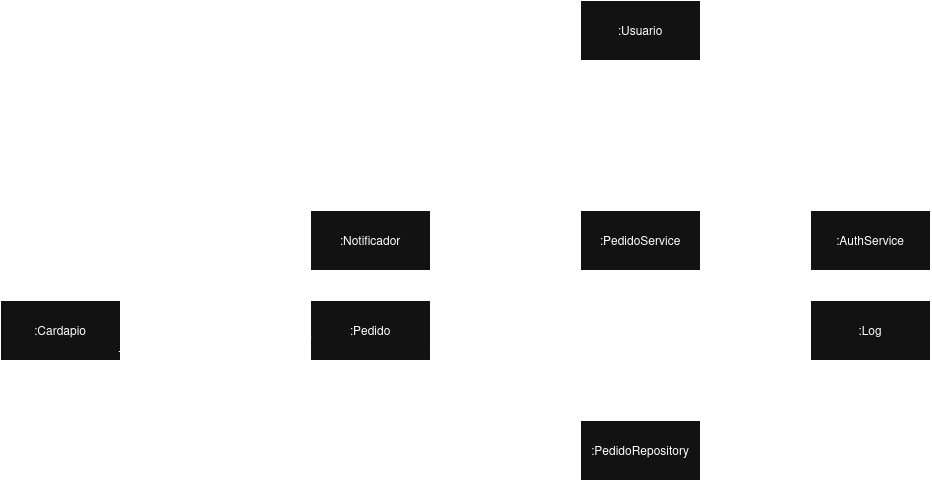

# Sistema de pedidos antecipados do restaurante universitário

Este documento fornece um *overview* do sistema construído no trabalho final da disciplina de Design de Software.

# Requisitos

Os requisitos funcionais e regras de negócio que o sistema deve implementar estão detalhados [aqui](./requisitos.md).

# Arquitetura

A arquitetura usada no sistema é um **Cliente-Servidor Monolítico Modular**, dadas sua facilidade de implementação inicial e características dadas pelo enunciado e pelos requisitos. Informações mais detalhadas podem ser encontradas na [documentação da arquitetura](./arquitetura.md).

# Alternativas arquiteturais e *trade-offs*

Apesar da arquitetura no estilo Cliente-Servidor Monolítico ter sido a escolhida para o trabalho, também foram consideradas outras alternativas, bem como os *trade-offs* que cada uma traz, [neste documento](./tradeoffs.md).

# ADRs

Foram registrados três ADRs que mostraram mais evidências à equipe de que a solução arquitetural escolhida é a mais adequada para o projeto. Os ADRs se encontram [neste diretório](./adr/).

# Diagramação

Os diagramas produzidos pela equipe se encontram [aqui](/docs/diagramas/), com cada tipo de diagrama tendo seu subdiretório.

## Diagrama de classes

O diagrama de classes abaixo:

Representa as interações entre as principais entidades do sistema, bem como suas respectivas multiplicidades e composições. A partir deste diagrama, surgiram os próximos.

## Diagramas de sequência

Foram pensados três casos de uso relevantes: Alterar Cardápio, Fazer Pedido (caso de uso principal) e Fazer *Login*. Para cada caso de uso, foi feito um diagrama de sequência correspondente. Acionadores de caso de uso (entidades `Controller`) e interfaces de comunicação com `Usuario` estão implícitas, a fim de simplificar os diagramas, e também porque o caso de uso é explícito. A seguir, uma breve descrição de cada diagrama, nas quais os possíveis fluxos serão descritos separadamente.

### Alterar Pedido

Fluxo principal (`Usuario` é um administrador do sistema, então pode alterar o cardápio):

1. `Usuario` se autentica através de `RULogin`
2. `RULogin` devolve um `Token` de sessão (por simplicidade, assumimos que o *login* foi bem-sucedido) para `Usuario`
3. `alterarCardapio()` é acionado em `RUCardapioService` pela requisição do `Usuario`
4. `RUCardapioService` chama `Cardapio` para realizar alguma alteração no cardápio
5. `Cardapio` devolve uma confirmação a `RUCardapioService`
6. `RUCardapioService` chama `RUNotificator` para emitir uma notificação de confirmação
7. `RUNotificator` notifica `Usuario` de que a tabela foi atualizada
8. `RUCardapioService` chama `Log` para registrar a alteração feita no cardápio
9. `Log` devolve uma confirmação do registro para `RUCardapioService`

Fluxo alternativo (`Usuario` não é um administrador do sistema, então seu acesso é negado):

1. `Usuario` se autentica através de `RULogin`
2. `RULogin` devolve um `Token` de sessão (por simplicidade, assumimos que o *login* foi bem-sucedido) para `Usuario`
3. `RUCardapioService` chama `RUNotificator` para emitir uma notificação de acesso negado
4. `RUNotificator` notifica `Usuario` de que sua ação não é permitida ou que seu acesso foi negado
5. `RUCardapioService` chama `Log` para registrar a tentativa de alteração no cardápio
6. `Log` devolve uma confirmação do registro para `RUCardapioService`

### Fazer Pedido

Fluxo principal (`Usuario` faz seu pedido com todos os itens disponíveis):

1. `Usuario` faz uma consulta ao cardápio, enviando a requisição para `PedidoService`
2. `PedidoService` chama `Cardapio` para realizar a consulta
3. `Cardapio` devolve o cardápio para `PedidoService`
4. `PedidoService` exibe o cardápio obtido para `Usuario`
5. Enquanto `Usuario` continuar escolhendo itens:
    1. `Usuario` seleciona um item
    2. `PedidoService` chama `Cardapio` para consultar a disponibilidade do item selecionado
    3. `Cardapio` devolve que o item selecionado está disponível
    4. `PedidoService` chama `Pedido` para adicionar o item ao pedido de `Usuario`
    5. `Pedido` devolve a `PedidoService` a confirmação de que o item foi adicionado
    6. `PedidoService` notifica `Usuario`, localmente, de que o item foi adicionado ao pedido
6. `Usuario` chama `PedidoService` para realizar o pedido
7. `PedidoService` chama `Pedido` para registrar o pedido
8. `PedidoService` chama `Log` para registrar o *log* do pedido
9. `Log` devolve uma confirmação do registro para `PedidoService`
10. `PedidoService` chama `RUNotificator` para emitir uma notificação da confirmação do pedido
11. `RUNotificator` devolve a notificação para `PedidoService`
12. `PedidoService` repassa a notificação para `Usuario`

Fluxo alternativo (`Usuario` faz seu pedido, mas ao menos 1 item se encontra indisponível):

1. `Usuario` faz uma consulta ao cardápio, enviando a requisição para `PedidoService`
2. `PedidoService` chama `Cardapio` para realizar a consulta
3. `Cardapio` devolve o cardápio para `PedidoService`
4. `PedidoService` exibe o cardápio obtido para `Usuario`
5. Enquanto `Usuario` continuar escolhendo itens:
    1. `Usuario` seleciona um item
    2. `PedidoService` chama `Cardapio` para consultar a disponibilidade do item selecionado
    3. Se o item estiver disponível, `Cardapio` devolve que o item selecionado está disponível, e que está indisponível caso contrário
    4. `PedidoService` chama `Pedido` para adicionar o item ao pedido de `Usuario`, caso ele esteja disponível
    5. `Pedido` devolve a `PedidoService` a confirmação de que o item foi adicionado; notifica localmente o usuário acerca da indisponibilidade do item caso este não esteja disponível
    6. `PedidoService` notifica `Usuario`, localmente, de que o item foi adicionado ao pedido
6. `Usuario` chama `PedidoService` para realizar o pedido
7. `PedidoService` chama `Pedido` para registrar o pedido
8. `PedidoService` chama `Log` para registrar o *log* do pedido
9. `Log` devolve uma confirmação do registro para `PedidoService`
10. `PedidoService` chama `RUNotificator` para emitir uma notificação da confirmação do pedido
11. `RUNotificator` devolve a notificação para `PedidoService`
12. `PedidoService` repassa a notificação para `Usuario`

<!-- Tem um problema nesse diagrama de sequência: é assumido que o status do item é sempre disponível. Cardapio deveria devolver apenas o status e o [alt] divide entre status == disponivel e status == indisponivel -->

### Fazer *Login*

Fluxo principal (autenticação ocorreu sem falhas):

1. `Usuario` informa suas credenciais na Tela da Aplicação
2. A Tela da Aplicação realiza requisição de *login* para `RULogin`
3. `RULogin` chama `AuthService` para autenticar as credenciais
4. `AuthService` devolve um *token*
5. `RULogin` devolve o *token* para a Tela da Aplicação
6. A Tela da Aplicação autentica o usuário

Fluxo alternativo (autenticação falhou):

1. `Usuario` informa suas credenciais na Tela da Aplicação
2. A Tela da Aplicação realiza requisição de *login* para `RULogin`
3. `RULogin` chama `AuthService` para autenticar as credenciais
4. `AuthService` devolve uma negativa de *login*
5. `RULogin` devolve a negativa de *login* para a Tela da Aplicação
6. A Tela da Aplicação notifica o usuário de que a autenticação falhou

## Diagrama de componentes

O diagrama de componentes abaixo:

Expõe os componentes do sistema e os contratos expostos por cada um para que ocorra a comunicação entre eles. É importante que sejam destacados alguns pontos:

- `CardapioService` dispõe de comunicação bidirecional com o Banco de Dados para indicar leitura e escrita
- O serviço de autenticação é um componente externo, então é mostrado separadamente

## Diagramas de comunicação

Os seguintes diagramas mostram o passo-a-passo da comunicação no sistema para (atualmente) dois casos de uso: Alterar Cardápio e Fazer Pedido (caso de uso principal). Serão descritos os processos de comunicação nos diagramas. De forma similar aos diagramas de sequência, acionadores de caso de uso (entidades `Controller`) e interfaces de comunicação com `Usuario` estão implícitas.

### Alterar Cardápio

Fluxo de execução da comunicação:

1. `Usuario` envia requisição para `CardapioService` por `AlterarCardapio`
2. `CardapioService` chama `AuthService` com `ValidarUsuario`. Existem duas possibilidades de valor de retorno, dependendo da validade das credenciais de `Usuario` <!-- Como admin ou como usuário qualquer? -->:
    1. [valid] `AuthService` devolve `Ok` ou [invalid] `AuthService` devolve `Not Ok`
3. Supondo que `AuthService` devolveu `Ok`, `CardapioService` usa `AlterarCardapio` com `Cardapio` para alterar o cardápio
    1. `Cardapio` devolve uma instância, alterada, para `CardapioService`
4. `CardapioService` chama sua interface de repositório para fazerem as alterações persistirem, com `Salvar`
    1. O repositório devolve `Ok`, confirmando que as alterações foram salvas
5. `CardapioService` chama `Log` com `AdicionarLog` para registrar as alterações do cardápio em *log*
    1. `Log` devolve `Ok`, confirmando o registro
6. `CardapioService` chama `Notificador` com `EmitirNotificacao` para devolver notificar `Usuario` de que as alterações foram feitas
    1. `Notificador` devolve uma notificação de confirmação `Ok`
7. `CardapioService` devolve a notificação para `Usuario`

<!-- Tem um problema nesse diagrama: O passo 3 da comunicação foi omitido -->

### Fazer Pedido

Fluxo de execução da comunicação:

1. `Usuario` envia requisição para `PedidoService` por `AlterarCardapio`
2. `PedidoService` chama `AuthService` com `ValidarUsuario`. Existem duas possibilidades de valor de retorno, dependendo da validade das credenciais de `Usuario`:
    1. [valid] `AuthService` devolve `Ok` ou [invalid] `AuthService` devolve `Not Ok`
3. Supondo que `AuthService` devolveu `Ok`, `PedidoService` usa `CriarPedido` com `Pedido` para criar/fazer um pedido
    1. `Pedido` chama `Cardapio` com `ConsultarDisponibiliade` para consultar a disponibilidade do item
    2. [valid] `Cardapio` devolve `Ok`, o item está disponível ou [invalid] `Cardapio` devolve `Not Ok`, o item não está disponível
    3. [valid] `Pedido` devolve `Ok` para `PedidoService` ou [invalid] `Pedido` devolve `Not Ok` para `PedidoService`
4. [valid] `PedidoService` chama sua interface de repositório para fazerem as o pedido persistir, com `Salvar`
    1. O repositório devolve `Ok`, confirmando que o pedido foi salvo
5. `PedidoService` chama `Log` com `AdicionarLog` para registrar que o pedido foi feito em *log*
    1. `Log` devolve `Ok`, confirmando o registro
6. `PedidoService` chama `Notificador` com `EmitirNotificacao` para devolver notificar `Usuario` de que o pedido foi confirmado
    1. `Notificador` devolve uma notificação de confirmação `Ok`
7. `PedidoService` devolve a notificação para `Usuario`

<!-- Nesse diagrama, o passo 3 também foi omitido; a numeração do passo 5 se repete para 5. Salvar e para 5. AdicionarLog... Creio que AdicionarLog deva ser o passo 6 -->

# Visão geral da implementação

Nesta seção, apresentamos uma visão geral da implementação das interfaces, da tela da aplicação, dos modelos e dos serviços do sistema.

## Interfaces

O sistema expõe diversos contratos por interfaces, sendo eles:

- `CardapioRepository.py`, `LogRepository.py` e `PedidoRepository.py`, que fornecem contratos para lidar com a persistência do cardápio, dos *logs* e dos pedidos, respectivamente. Os códigos-fonte estão disponíveis [aqui](../src/database/interfaces/)
- `IAuthService.py`, `ICardapioService.py` e `IPedidoService.py`, que são fornecidos por seus respectivos serviços para que haja a comunicação entre os componentes do sistema. Os códigos-fonte estão disponíveis [aqui](../src/interfaces/)

## Implementação da persistência

Os contratos de persistência são implementados por `SQLAlchemyCardapioRepository.py`, `SQLAlchemyLogRepository.py` e `SQLAlchemyPedidoRepository.py`, com mapeamento objeto-relacional via SQLAlchemy. Os códigos-fonte estão disponíveis [aqui](../src/database/).

## Tela da aplicação

Foram implementadas telas simples com HTML, CSS e JavaScript para demonstrar o funcionamento de um protótipo executável do sistema. Os códigos-fonte estão disponíveis [aqui](../templates/).

## Modelos
O modelo do sistema foi implementado pelas seguintes classes:

- `Cardapio.py`, que permite a criação de novos itens do cardápio, a adição, remoção e atualização de itens e a consulta pela disponibiidade de um dado item
- `Item.py`, que permite que a disponibilidade de um item seja atualizada conforme a necessidade
- `ItemCardapio.py`, que funciona da mesma forma que `Item.py`
- `ItemPedido.py`, que é apenas instanciado e não possui nenhum método em particular
- `Pedido.py`, que permite a adição e remoção de itens do pedido, a consulta para decidir se o pedido está vazio e a consulta para decidir se é possível cancelar o pedido

Os códigos-fonte estão disponíveis [aqui](../src/models/).

## Serviços

Os serviços (*services*), ou ainda, os orquestradores de caso de uso do sistema, foram implementados pelas seguintes classes:

- `CardapioService.py`, que permite a consulta pelo cardápio mais recente, a criação e registro de um novo cardápio, a atualização do cardápio e a consulta pela disponibilidade de um item no cardápio mais recente
- `LoginService.py`, que orquestra os casos de uso relacionados a autenticação dos usuários
- `PedidoService.py`, que permite a realização de um pedido, a consulta por um pedido e o cancelamento de um pedido

Os códigos-fonte estão disponíveis [aqui](../src/services/).

### Autores

Sofia Barbosa Candiotto, Eduarda Saibert, Caio Eduardo Ferreira de Miranda, Kawai Barzotto.
